# دليل الشيخ والمشرف — لوحة أوراد

اللوحة موقع على الويب تتابع منه طلابك: من سجّل ومن انقطع، والحضور، وطلبات الدعم، والعادات، والتقارير.
تعمل على الحاسوب والجوال، والأوضح على شاشة الحاسوب.

**من يرى ماذا؟**

- **المدير (الشيخ)** يرى كل المجموعات ويفعل كل شيء.
- **المشرف** يرى طلاب مجموعاته وحدهم، ويسجّل حضورهم، ويعالج طلبات دعمهم. لا يدعو طلابًا ولا يعدّلهم،
  ولا يفتح صفحتَي «العادات» و«الإعدادات».

الأقسام في الشريط الجانبي: نظرة عامة، الطلاب، الحضور، طلبات الدعم، العادات، التقارير، الإعدادات.

> اللقطات من نسخة تجريبية بأسماء وهمية.

## 1. الدخول برمز البريد

لا كلمة مرور.

1. افتح رابط اللوحة، واكتب بريدك في «البريد الإلكتروني»، ثم اضغط «أرسل رمز الدخول».
2. يصلك بريد من «أوراد» فيه رمز من ست خانات، صلاحيته عشر دقائق.
3. اكتب الرمز في «رمز الدخول المكوّن من 6 أرقام»، ثم اضغط «تأكيد الرمز».

لم يصل الرمز؟ انتظر حتى يتاح «إعادة الإرسال». كتبت بريدًا خاطئًا؟ اضغط «تغيير البريد».
للخروج: «تسجيل الخروج» أسفل الشريط الجانبي.

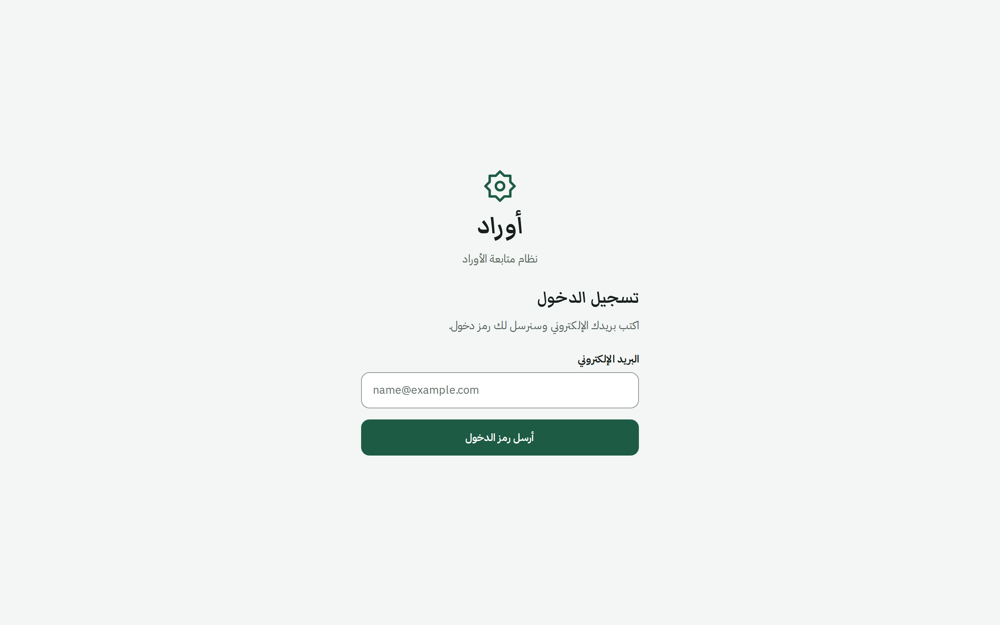

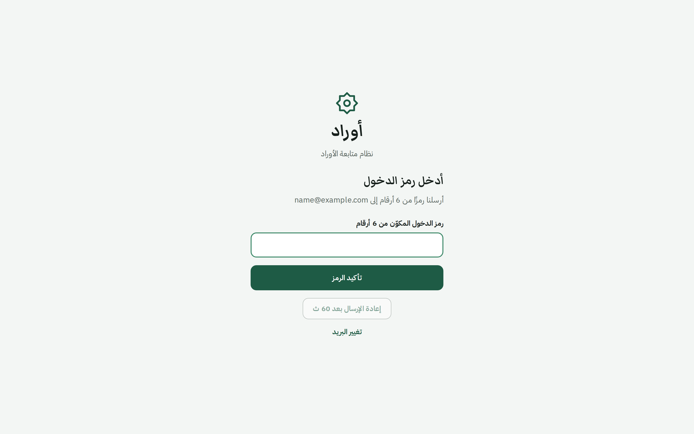

رسائل قد تراها:

| الرسالة | ماذا تفعل |
|---|---|
| اكتب بريدًا إلكترونيًا صحيحًا. | صحّح البريد. |
| هذا البريد غير مسجَّل لدينا. تواصل مع المشرف. | البريد ليس لحساب في النظام. |
| تعذّر إرسال الرمز. تحقّق من اتصالك وحاول مرة أخرى. | تحقّق من الاتصال وأعد المحاولة. |
| الرمز غير صحيح أو انتهت صلاحيته. حاول مرة أخرى. | أعد كتابته، أو اطلب رمزًا جديدًا. |
| تعذّر التحقّق من الرمز. تحقّق من اتصالك وحاول مرة أخرى. | مشكلة اتصال. |
| هذه اللوحة للمشرفين | دخلت بحساب طالب. الطالب يسجّل من التطبيق. |
| حسابك غير مفعَّل، تواصل بالمدير | عُطّل حسابك؛ يفعّله المدير. |

## 2. النظرة العامة

أول صفحة بعد الدخول. فوقها ثلاث بطاقات:

- **سجّلوا هذا الأسبوع**: نسبة الطلاب المعروضين الذين سجّلوا في الأسبوع الحالي، وتحتها عدد المعروضين.
- **منقطعون ≥3 أيام**: من لم يسجّلوا اليوم ولا في الأيام الثلاثة قبله.
- **طلبات دعم مفتوحة**: الطلبات التي تنتظر المعالجة.

البطاقة التي تستحقّ الانتباه تظهر بإطار أحمر وعلامة ⚠.

تحتها جدول «الطلاب في آخر 14 يومًا»: صفّ لكل طالب مُتابَع، وخانة لكل يوم بالتاريخين الهجري والميلادي.
حالات اليوم أربع، ولكلٍّ شكل:

- **مُنجَز**: مربّع ممتلئ. أتمّ الطالب كل المطلوب في يومه.
- **غير مُنجَز**: مربّع مخطَّط. سجّل لكن لم يُتمّ المطلوب.
- **بلا تكليف**: مربّع فارغ. كل أوراد اليوم «غير مطلوب».
- **غير مسجَّل**: نقطة.

وفي آخر الصفّ «السلسلة» و«الإنجاز». علامة ⚠ بجانب السلسلة تعني: منقطع 3 أيام أو أكثر.
اضغط اسم الطالب لتفتح صفحته. «المجموعة» في الأعلى تحصر الجدول في مجموعة واحدة.

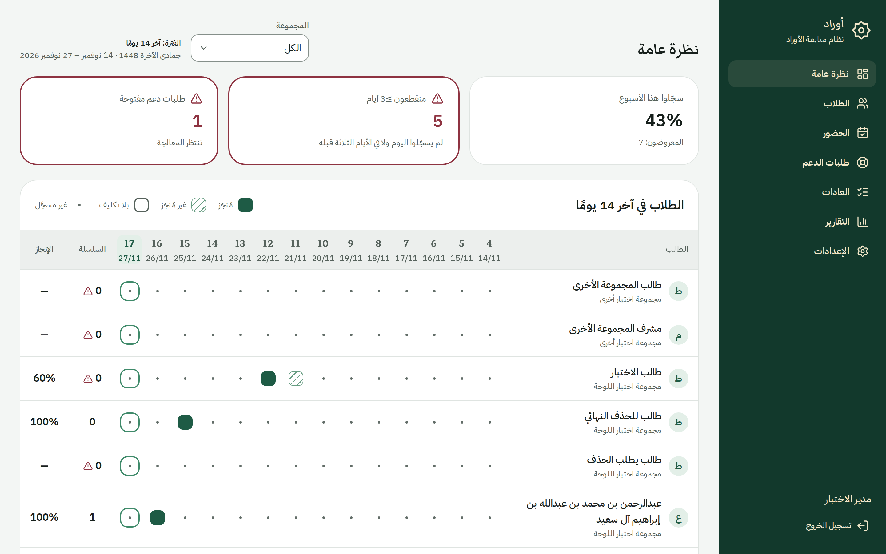

إن لم يكن عندك طلاب بعد تظهر «لا طلاب بعد» ومعها زر «دعوة طالب».
وإن ظهر «تعذّر تحميل النظرة العامة. تحقّق من الاتصال وأعد تحميل الصفحة.» فأعد تحميل الصفحة.

## 3. دعوة طالب (للمدير)

1. في «الطلاب» اضغط «دعوة طالب».
2. املأ:
   - «الاسم الكامل».
   - «البريد الإلكتروني»: البريد الذي سيدخل به الطالب.
   - «المجموعة».
   - «تاريخ الانضمام إلى البرنامج»: افتراضيًا اليوم؛ تبدأ منه السلاسل والنسب.
   - «مُتابَع (يسجّل أوراده ويظهر في المتابعة)»: اتركه مفعّلًا للطالب.
3. اضغط «أرسل الدعوة». تفتح صفحة الطالب الجديد.

**ما يصل الطالب:** بريد من «أوراد» فيه رمز دخول من ست خانات، صلاحيته عشر دقائق. يفتح التطبيق ويدخل ببريده،
وإن انتهت صلاحية الرمز طلب رمزًا جديدًا من شاشة الدخول. أرسل له مع الدعوة [دليل الطالب](student-guide.md) ورابط التطبيق.

> في النسخة التجريبية الحالية لا تخرج الرسائل إلى صناديق البريد الحقيقية؛ تُجمع في صندوق تجريبي يفتحه الفريق.
> إرسال البريد الحقيقي يأتي مع بيئة الإنتاج (انظر [دليل التشغيل](runbook.md)).

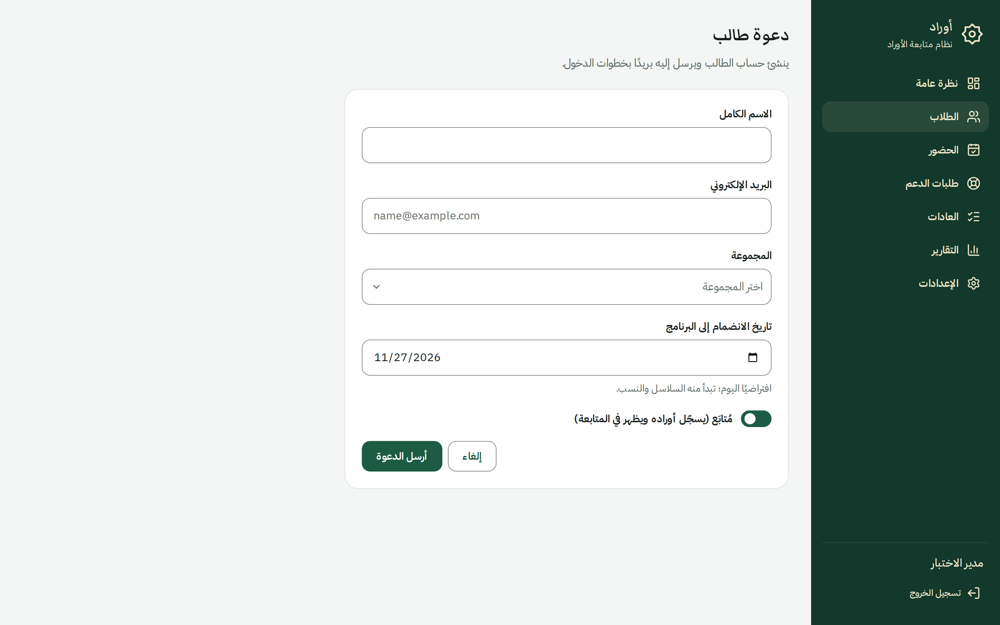

رسائل قد تراها:

| الرسالة | معناها |
|---|---|
| أنشئ مجموعة أولًا من الإعدادات. | لا مجموعات بعد. |
| راجع الحقول المعلَّمة. | تحت كل حقل خاطئ سببه: «اكتب الاسم.»، «اكتب بريدًا إلكترونيًا صحيحًا.»، «اختر مجموعة.»، «اختر تاريخًا لا يتجاوز اليوم.» |
| هذا البريد مسجَّل لحساب آخر. | البريد لحساب موجود. |
| تعذّرت الدعوة. تحقّق من الاتصال وحاول مرة أخرى. | لم يُنشأ الحساب؛ أعد المحاولة. |
| هذا الإجراء للمدير وحده. | الدعوة للمدير. |

**إضافة مشرف:** هذه الصفحة تدعو طلابًا فقط. المشرف يُنشأ اليوم بطلب من فريق التشغيل (انظر
[دليل التشغيل](runbook.md) §5)، ثم تختاره مشرفًا لمجموعته من الإعدادات.

## 4. الطلاب وصفحة الطالب

### القائمة

تعرض «الطلاب» كل الحسابات: الاسم، المجموعة، الحالة، تاريخ الانضمام، ومُتابَع.

- «ابحث بالاسم» للبحث.
- «المجموعة» و«الحالة» («نشط» أو «معطَّل») للتصفية.
- «المعروض: 5/8» يبيّن عدد ما تراه من الكل.

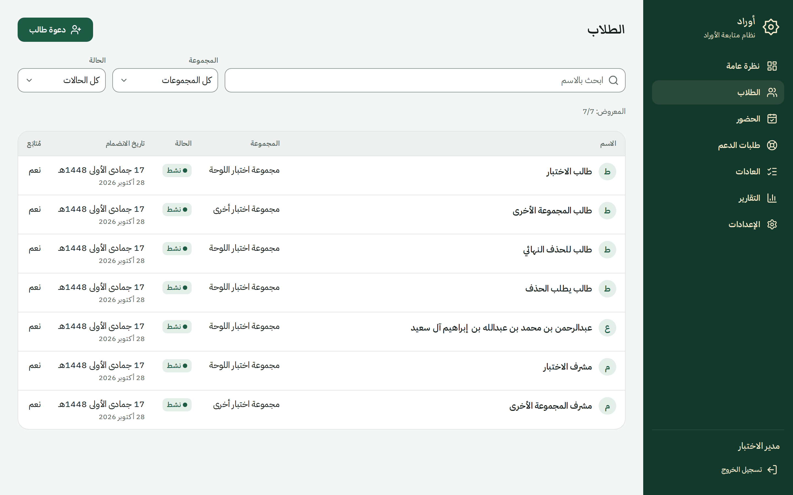

### صفحة الطالب

اضغط اسم طالب لتفتح صفحته. فيها:

- **الملخّص**: أيام مسجَّلة، نسبة الإنجاز، نسبة الحضور، أطول سلسلة، السلسلة الحالية.
- **هذا الشهر**: تقويم بحالة كل يوم.
- **آخر السجلّات**: التاريخ، النوع (يومي أو أسبوعي)، الحالة، الملاحظة أو المراجعة، وطلب الدعم إن وُجد.
- **الحضور**: المجالس التي سُجّل فيها.

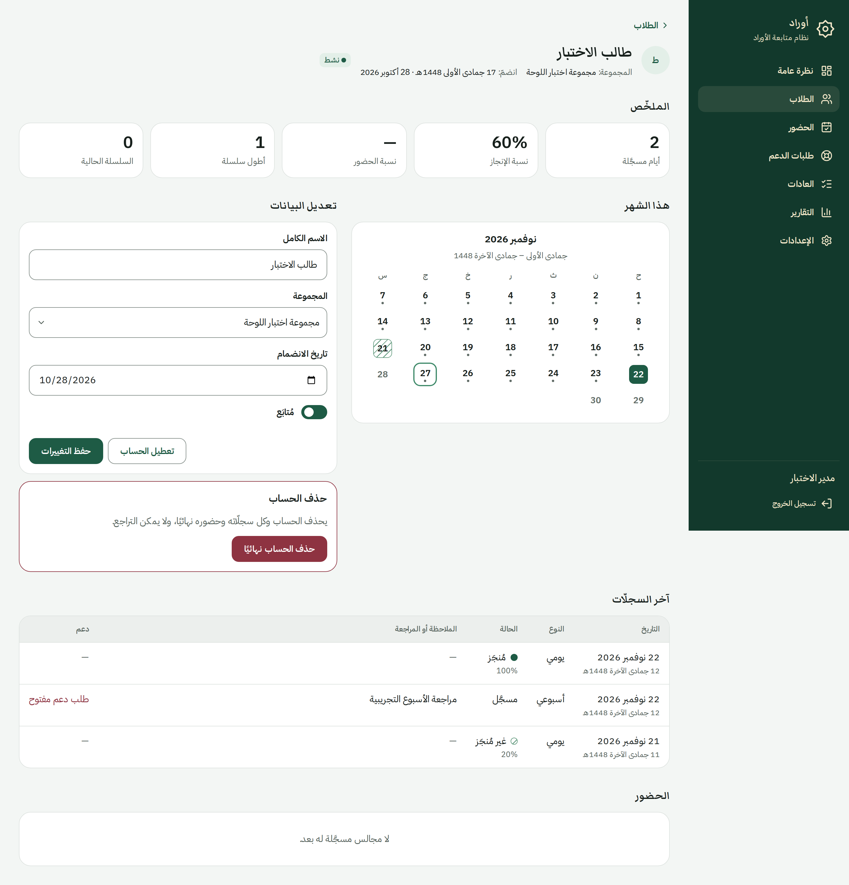

### تعديل البيانات (للمدير)

في «تعديل البيانات» تغيّر الاسم الكامل، والمجموعة، وتاريخ الانضمام، و«مُتابَع». ثم «حفظ التغييرات»،
فيظهر «حُفظت التغييرات.».

- **مُتابَع أو غير مُتابَع:** المُتابَع يظهر في النظرة العامة والحضور ويُحسب في النسب. أطفئه لحساب لا يسجّل
  أورادًا، كمشرف لا يشارك.
- **تعطيل الحساب:** «تعطيل الحساب» يمنع صاحبه من الدخول، ويُبقي سجلّاته كما هي. يُعاد بـ«تفعيل الحساب».
  استعمله لطالب انقطع أو غادر.
- **حذف الحساب:** «حذف الحساب نهائيًا» يحذف الحساب وكل سجلّاته وحضوره، ولا يمكن التراجع. يُطلب منك تأكيد
  مرتين: تقرأ ما سيُحذف، ثم تكتب الاسم الكامل للطالب، ثم «حذف نهائي». الأفضل غالبًا التعطيل لا الحذف.

رسائل قد تراها: «لا يمكنك تعطيل حسابك أو حذفه بنفسك.»، «تعذّر حفظ التغييرات. حاول مرة أخرى.»،
«تعذّر حذف الحساب. حاول مرة أخرى.»، «هذا الحساب غير موجود أو لا تملك صلاحية عرضه.».

## 5. الحضور

### إنشاء مجلس

1. في «الحضور» اضغط «مجلس جديد».
2. اختر «التاريخ» (افتراضيًا اليوم)، واكتب «العنوان (اختياري)»، مثل «درس الفقه».
3. اختر «المجموعة». المدير يستطيع اختيار «كل المجموعات» لمجلس مشترك.
4. اضغط «إنشاء المجلس». تفتح صفحة المجلس.

قائمة المجالس تعرض لكلٍّ تاريخه ومجموعته و«المسجَّل 4/5» (من عُلِّمت حالته من مجموع الحاضرين المتوقَّعين).

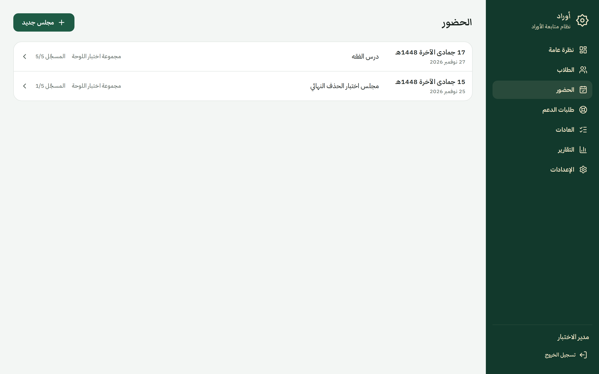

### تسجيل الحضور

في صفحة المجلس قسم لكل مجموعة، وفيه كل مُتابَع منها. لكلٍّ أربع حالات: «لم يُسجَّل»، «حاضر»، «غائب»، «معذور».

1. اضغط «الكل حاضر»: يعلّم «حاضر» من لا حالة له فقط، ولا يغيّر ما عُلِّم.
2. غيّر حالة الغائب والمعذور.
3. اضغط «حفظ». يظهر «حُفظ الحضور.» وتحته العدّ وآخر حفظ.

المشرف يرى في المجلس المشترك قسم مجموعته وحده.

**المعذور:** لا يُحسب في نسبة الحضور: لا له ولا عليه. يتغيّر ذلك بإعداد «احتساب المعذور غيابًا» (§10).

لحذف مجلس: «حذف المجلس» ثم «احذف المجلس». يُحذف المجلس وكل ما سُجّل فيه من حضور، ولا يمكن التراجع.

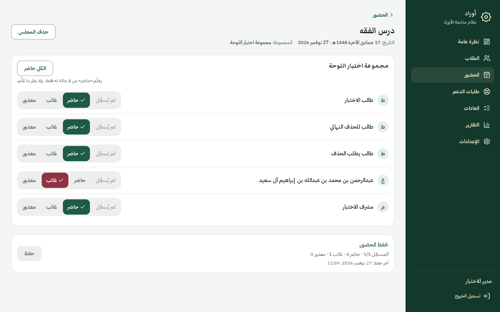

رسائل قد تراها:

| الرسالة | معناها |
|---|---|
| اختر المجموعة. / اختر تاريخًا صحيحًا. / العنوان طويل؛ اختصره إلى 200 حرف. | صحّح الحقل. |
| تعذّر إنشاء المجلس. حاول مرة أخرى. | أعد المحاولة. |
| تعذّر حفظ الحضور. تحقّق من الاتصال وحاول مرة أخرى. | لم يُحفظ شيء؛ أعد الحفظ. |
| في القائمة من لا يُسجَّل حضوره في هذا المجلس. أعد تحميل الصفحة وحاول مرة أخرى. | تغيّرت المجموعة أثناء التسجيل. |
| لا تملك صلاحية هذا الإجراء على هذا المجلس. | المجلس لمجموعة لا تشرف عليها. |
| لا أحد مُتابَع في هذا المجلس ضمن مجموعاتك. | لا طلاب مُتابَعين في مجموعاتك. |

## 6. العادات واستبدالها (للمدير)

التطبيق يقرأ العادات من هنا. لها تبويبان: «اليومية» و«الأسبوعية». لكل عادة: الاسم، والهدف، والنوع
(«ثلاثية» = تم · لم يتم · غير مطلوب، أو «قائمة» ببنود)، و«نشطة منذ».

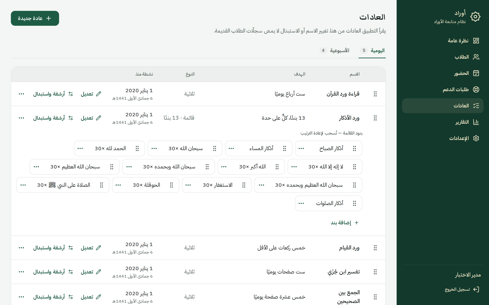

- **عادة جديدة:** «عادة جديدة»، ثم الاسم، والهدف، والتكرار، والنوع، وتاريخ البدء (والبنود للقائمة)، ثم «إضافة العادة».
- **تصحيح اسم أو هدف:** «تعديل». التصحيح يظهر على السجلّات القديمة أيضًا. استعمله لخطأ إملائي فقط.
- **الترتيب:** اسحب العادة من مقبضها. يظهر «حُفظ الترتيب.».
- **بنود القائمة:** «إضافة بند»، أو أرشفة بند لم يعد مطلوبًا.

### الانتقال إلى كتاب جديد: «أرشفة واستبدال»

حين تنتهي من كتاب وتنتقل إلى آخر لا تعدّل اسم العادة؛ استبدلها، فيبقى تاريخ الطلاب في الكتاب الأول صحيحًا.

1. اضغط «أرشفة واستبدال» في صفّ العادة.
2. اكتب «اسم العادة الجديدة»، و«الهدف»، و«الوصف (اختياري)» إن شئت. وللقائمة: «بنود القائمة الجديدة (بند في كل سطر)».
3. اختر «تاريخ البدء» (افتراضيًا الغد). تحت الحقل ترى متى تبدأ الجديدة ومتى تنتهي القديمة.
4. اضغط «أرشفة واستبدال».

تنتهي العادة الحالية في اليوم السابق لتاريخ البدء وتبقى سجلّاتها كما هي، وتظهر الجديدة للطلاب من تاريخ البدء.
القديمة تنتقل إلى «المؤرشفة».

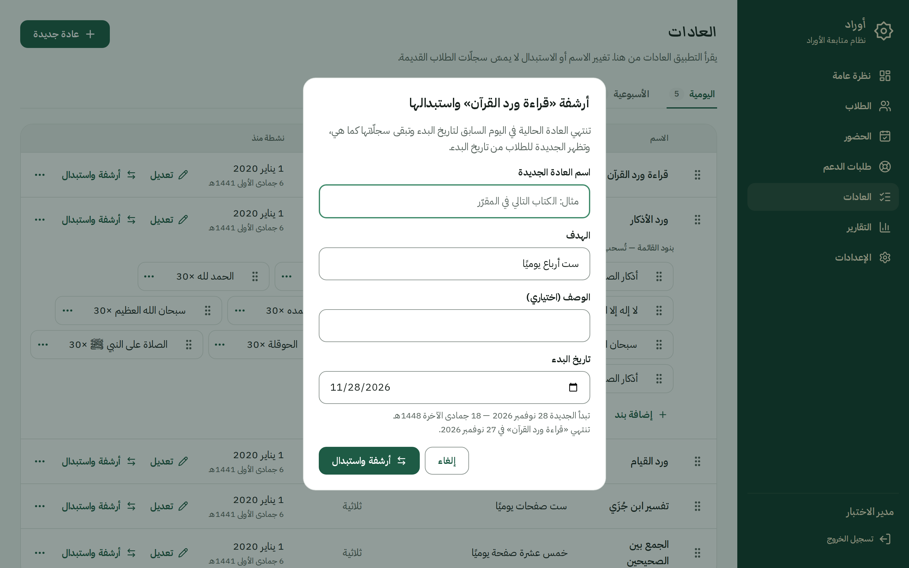

### لماذا لا تُحذف عادة لها سجلّات؟

الحذف يمحو ما سجّله الطلاب فيها، فتتغيّر نسبهم وسلاسلهم الماضية. لذلك: الحذف متاحٌ لعادةٍ بلا سجلّات فقط؛
ما له سجلّات يُؤرشف ويُستبدل. «أرشفة» وحدها تُخفي العادة بعد آخر يوم تختاره، وتبقى سجلّاتها كما هي.

رسائل قد تراها:

| الرسالة | معناها |
|---|---|
| لهذه العادة أو البند سجلّات، فلا يُحذف. أرشِفه بدلًا من ذلك. | استعمل «أرشفة» أو «أرشفة واستبدال». |
| تاريخ البدء يجب أن يأتي بعد بداية العادة الحالية وبعد آخر يوم سُجّلت فيه. | اختر تاريخًا أبعد. |
| هذه العادة مؤرشفة بالفعل. أعد تحميل الصفحة. | سبقك أحد إلى أرشفتها. |
| بيانات العادة الجديدة غير صالحة: تحقّق من الاسم والبنود. | راجع الاسم والبنود. |
| اختر تاريخًا من اليوم فصاعدًا. / اكتب بندًا واحدًا على الأقل. | صحّح الحقل. |
| إدارة العادات للمدير وحده. | الصفحة للمدير. |

## 7. طلبات الدعم وطلبات حذف الحساب

ما يكتبه الطالب في «ما تحتاج فيه دعمًا من الشيخ» في مراجعته الأسبوعية يصل هنا. ثلاثة تبويبات:
«المفتوحة»، «المعالَجة»، «طلبات حذف الحساب».

### معالجة طلب دعم

1. في «المفتوحة» اقرأ المراجعة والطلب.
2. تواصل مع الطالب بالطريقة التي تراها.
3. اضغط «تمّت المعالجة»، واكتب «ملاحظة داخلية (اختياري)» إن شئت. لا يراها الطالب؛ تظهر للمدير ولمشرف المجموعة.
4. اضغط «تمّت المعالجة». ينتقل الطلب إلى «المعالَجة» (تظهر فيها طلبات آخر 90 يومًا).

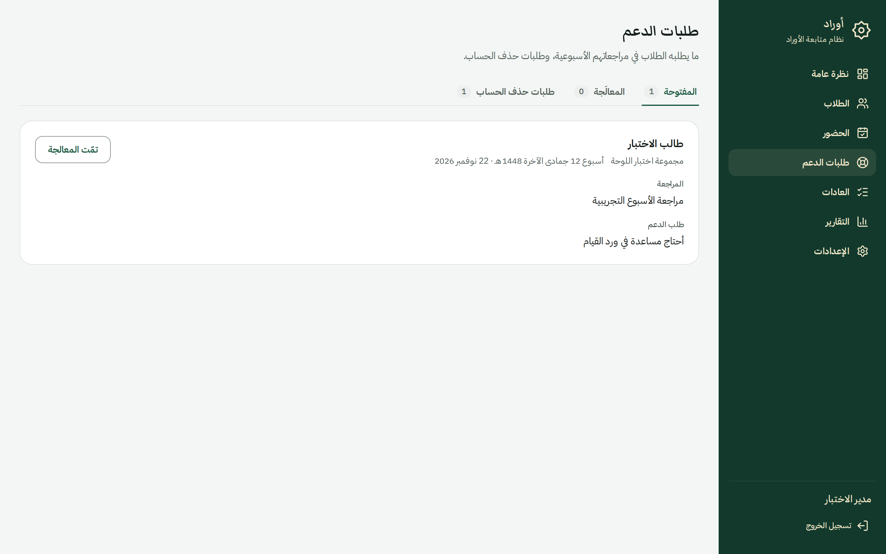

### طلبات حذف الحساب

الطالب يطلب حذف حسابه من إعدادات التطبيق، ويُنفَّذ الطلب من هنا خلال 30 يومًا. على كل طلب تاريخه و«آخر موعد للتنفيذ»،
وعلامة «متأخّر» إن فات الموعد.

- **التنفيذ:** «حذف نهائي»، ثم التأكيد المزدوج نفسه (اكتب الاسم الكامل، ثم «حذف نهائي»). يُحذف الحساب والسجلّات والحضور
  وطلبات الدعم نهائيًا.
- **الرفض:** «رفض الطلب»، مثلًا إن تراجع الطالب.

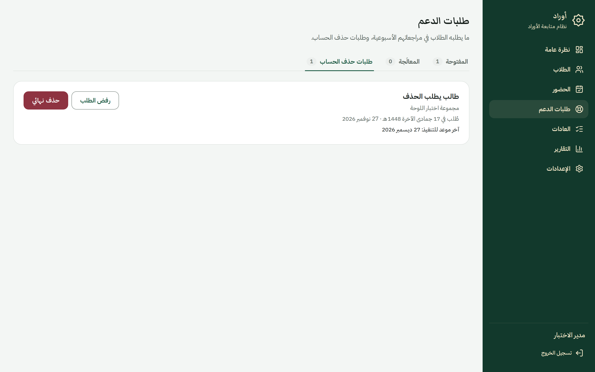

رسائل قد تراها: «لا تملك صلاحية معالجة هذا الطلب.»، «الملاحظة طويلة؛ اختصرها إلى 2000 حرف.»،
«لم يعد هذا الطلب قائمًا. أعد تحميل الصفحة.»، «تعذّر الحفظ. تحقّق من الاتصال وحاول مرة أخرى.».

## 8. التقارير والتصدير إلى Excel

1. في «التقارير» اختر «نوع التقرير»: «السجلّ اليومي» أو «السجلّ الأسبوعي» أو «الحضور».
2. اختر «الفترة»: «هذا الشهر» أو «الشهر الماضي» أو «آخر 30 يومًا»، أو اكتب «من» و«إلى».
3. اختر «المجموعة» أو «الكل».
4. اضغط «تنزيل CSV».

في الملف صفّ لكل طالب في كل يوم أو أسبوع أو مجلس، بالتاريخين الهجري والميلادي، ونسبة اليوم، وحالة كل عادة
(«تم»، «لم يتم»، «غير مطلوب»)، والملاحظة. الملف بترميز UTF-8 مع علامة BOM، فيفتحه Excel بالعربية مباشرةً:
افتحه بالنقر المزدوج.

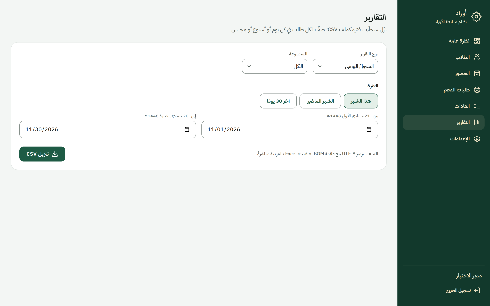

إن تعطّل زر التنزيل فتحته السبب: «اختر تاريخين صحيحين.»، أو «تاريخ البداية بعد تاريخ النهاية.»، أو
«الفترة أطول من 366 يومًا؛ قسّمها إلى ملفّين.». وللمشرف بلا مجموعات: «لا مجموعات تشرف عليها بعد؛ سيخرج الملف بلا صفوف.».

## 9. استيراد السجلّات القديمة من Google Sheets

الاستيراد لا يجري من اللوحة. يشغّله فريق التشغيل مرة واحدة بالأداة `scripts/import-legacy`، فتظهر سجلّات الطلاب
القديمة وسلاسلهم في ملخّصاتهم.

**ما تجهّزه أنت (الشيخ):**

1. صدّر من Google Sheets ثلاثة ملفات CSV: ردود النموذج اليومي، وردود الأسبوعي، وجدول الحضور. أرسلها إلى الفريق
   بطريقة خاصة، لا في مجموعة عامة؛ فيها بيانات طلاب.
2. ادعُ الطلاب الحاليين في اللوحة قبل الاستيراد (§3)، وأنشئ في «العادات» أي عادة قديمة انتهت (كتاب قديم) بتاريخيها.
3. **راجع ملف الربط مع الفريق.** أول تشغيل لا يستورد شيئًا؛ يكتب مسودة تربط:
   - كل اسم كتبه الطالب بيده في النماذج بحسابه في النظام. الأسماء المكتوبة بأشكال مختلفة تحتاج قرارك:
     التقرير يقترح الأقرب، ولا يعتمده وحده.
   - كل عمود في الجدول بعادته.
   - الطالب الذي غادر: يُنشأ له حساب معطَّل يحفظ تاريخه، أو لا يُستورد.
   - الخانة الفارغة: «غير مطلوب» (الافتراضي) أو «لم يتم».

**ما يفعله الفريق:**

1. **معاينة:** تشغيل بلا كتابة، يخرج ملخّصًا بالعربية: كم سجلًّا سيُستورد، والأسماء غير المربوطة، والصفوف التي ستُرفض وسببها.
2. **التنفيذ** بعد موافقتك على المعاينة. إعادة التشغيل آمنة: لا تكرّر سجلًّا.

بعد التنفيذ يرجع «تاريخ الانضمام» لكل طالب إلى أقدم يوم مستورد له، فتُحسب سلاسله القديمة.

## 10. الإعدادات (للمدير)

ما يُضبط هنا يغيّر سلوك التطبيق واللوحة لكل الطلاب والمشرفين.

### إعدادات النظام

| الإعداد | معناه | الافتراضي |
|---|---|---|
| عتبة اليوم المُنجَز (%) | نسبة الإنجاز التي يُعدّ بها اليوم مُنجَزًا ويدخل في السلسلة، من 50 إلى 100. | 100 |
| نافذة التعديل (أيام) | كم يومًا سابقًا يستطيع الطالب أن يسجّله أو يعدّله، من 0 إلى 14. | 2 |
| مهلة المراجعة الأسبوعية (أيام) | أيام بعد نهاية الأسبوع يُقبل فيها حفظ مراجعته، من 0 إلى 7. | 3 |
| تعديل التاريخ الهجري (أيام) | يُضاف إلى تقويم أم القرى في التطبيق واللوحة إن خالف رؤية الهلال، من −2 إلى 2. | 0 |
| احتساب المعذور غيابًا | إن فُعِّل دخل المعذور في نسبة الحضور غائبًا، وإلا استُثني منها. | مطفأ |
| وقت التذكير الافتراضي | وقت التذكير اليومي لكل حساب جديد، ويغيّره الطالب من إعداداته. | 21:00 |

غيّر القيمة ثم «حفظ». يظهر «حُفظت الإعدادات.». القيمة خارج مداها تُرفض وتحتها السبب، مثل
«أدخل عددًا صحيحًا من 0 إلى 14.».

### المجموعات

لكل مجموعة: الاسم، و«المنطقة الزمنية»، و«بداية الأسبوع»، و«المشرفون»، وعدد الأعضاء.

- «مجموعة جديدة» أو «تعديل»، ثم «اسم المجموعة»، و«المنطقة الزمنية» (مناطق المنطقة العربية أولًا)، و«بداية الأسبوع»،
  و«المشرفون» (يرى المشرف طلاب المجموعة ويسجّل حضورهم).
- المنطقة الزمنية تحدّد «اليوم» لطلاب المجموعة، وبداية الأسبوع تحدّد أسبوعهم ومراجعتهم. تغييرهما يغيّر ذلك لكل طلاب المجموعة.

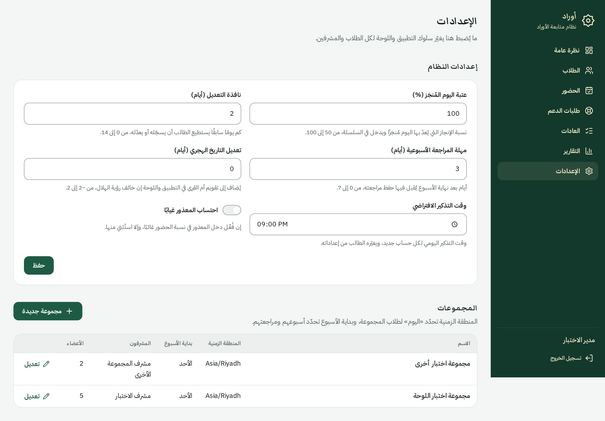

رسائل قد تراها: «هذا الاسم لمجموعة أخرى؛ اختر اسمًا غيره.»، «اختر منطقة زمنية من القائمة.»،
«أحد المشرفين المختارين لم يعد متاحًا. أعد تحميل الصفحة.»، «لا مشرفين مفعَّلين بعد.»،
«تعذّر الحفظ. تحقّق من الاتصال وحاول مرة أخرى.».
