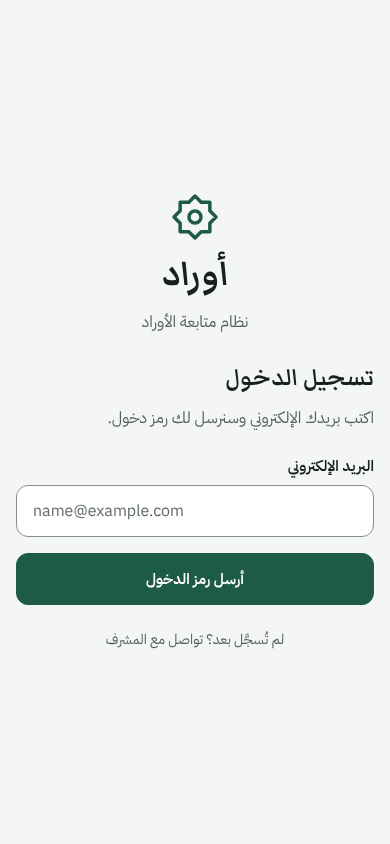
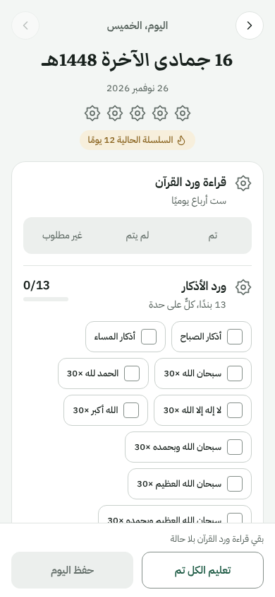
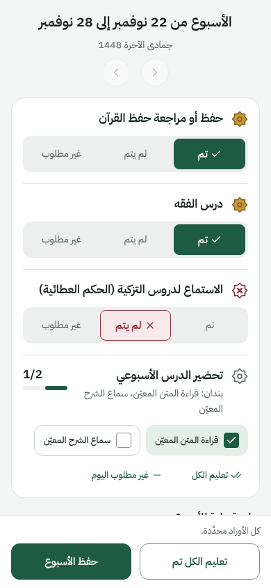
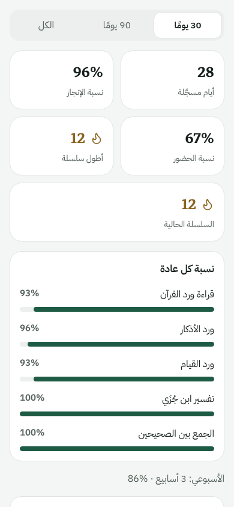
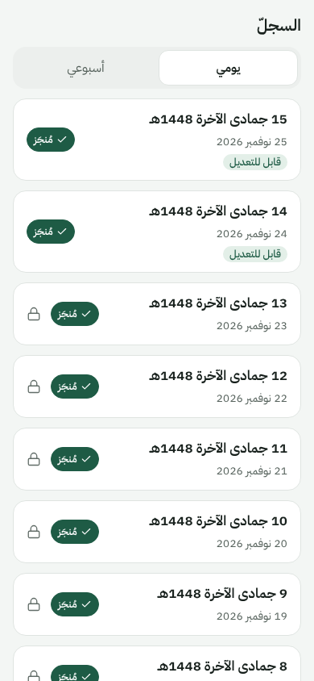
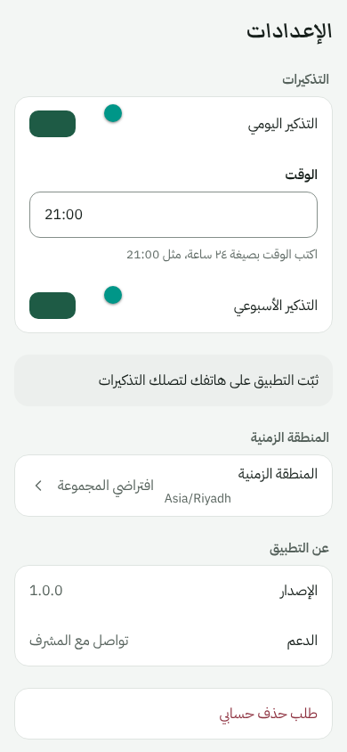

# دليل الطالب — أوراد

هذا الدليل يحلّ محلّ دليل الطالب القديم. كان لكل طالب **ثلاثة روابط**: نموذج يومي، ونموذج أسبوعي، وملف
«متابعتي». صار لك اليوم **حساب واحد** في تطبيق «أوراد»، تدخله ببريدك، وفيه كل ما كانت تفعله الروابط الثلاثة.

## ما الذي تغيّر؟

| كنت تفعل | صرت تفعل |
|---|---|
| تفتح رابط النموذج اليومي كل يوم | تفتح تبويب **«اليوم»** وتسجّل أورادك |
| تفتح رابط النموذج الأسبوعي كل أسبوع | تفتح تبويب **«أسبوعي»** وتسجّل أوراد الأسبوع ومراجعتك |
| تقرأ ملف «متابعتي» | تفتح تبويب **«ملخّصي»** |
| تكتب اسمك بيدك في كل نموذج | لا تكتبه: الحساب يعرّفك |
| تكتب التاريخ بيدك | التاريخ يُحسب تلقائيًا بتوقيت مجموعتك |
| تحفظ الروابط سرًّا لأن من يملكها يكتب باسمك | لا يدخل حسابك إلا من يقرأ بريدك |
| تتذكّر وحدك | يصلك تذكير يومي وأسبوعي على الجوّال (حين يصدر التطبيق في المتاجر) |
| تكتب طلب الدعم في النموذج الأسبوعي | تكتبه في الأسبوعي أيضًا، فيصل إلى الشيخ ومشرف مجموعتك |

القواعد القديمة باقية: ترى بياناتك وحدك، ولا يرى زملاؤك شيئًا منها. والحضور يسجّله الشيخ أو المشرف، لا أنت.
ونسيان يوم ما زال مقبولًا: سجّله في اليوم التالي واستمرّ.

## 1. فتح التطبيق

- **الآن: على المتصفّح.** افتح الرابط الذي يرسله إليك المشرف في متصفّح جوالك أو حاسوبك.
  يمكنك إضافته إلى الشاشة الرئيسة من قائمة المتصفّح ليفتح كالتطبيق.
- **لاحقًا: من المتاجر.** سيصدر التطبيق على App Store وGoogle Play، والحساب نفسه يعمل فيهما.
  التذكيرات تصل إلى تطبيق الجوّال وحده؛ على المتصفّح يظهر لك تنبيه: «ثبّت التطبيق على هاتفك لتصلك التذكيرات».

## 2. الدخول برمز البريد

لا كلمة مرور. حين يدعوك المشرف يصلك بريد من «أوراد» فيه رمز دخول من ست خانات.

1. اكتب بريدك في خانة «البريد الإلكتروني»، ثم اضغط «أرسل رمز الدخول».
2. افتح بريدك وانسخ الرمز ذا الست خانات. صلاحيته عشر دقائق.
3. اكتب الرمز في «رمز الدخول المكوّن من 6 أرقام». يتحقّق التطبيق منه وحده حين تكتب الخانة السادسة؛ لا زرّ تأكيد.

لم يصلك الرمز؟ انتظر حتى يتاح زر «إعادة الإرسال»، وابحث في مجلّد الرسائل غير المرغوبة.
كتبت بريدًا خاطئًا؟ اضغط «تغيير البريد».

رسائل قد تراها:

| الرسالة | معناها |
|---|---|
| هذا البريد غير مسجَّل لدينا. تواصل مع المشرف. | لم يُدعَ هذا البريد بعد، أو كتبته بغير ما سجّله المشرف. |
| الرمز غير صحيح أو انتهت صلاحيته. حاول مرة أخرى. | أعد كتابة الرمز، أو اطلب رمزًا جديدًا. |
| تعذّر إرسال الرمز. تحقّق من اتصالك وحاول مرة أخرى. | مشكلة اتصال. |
| حسابك غير مفعَّل، تواصل مع المشرف | عطّل المشرف حسابك؛ اسأله. |

## 3. أوراد اليوم (تبويب «اليوم»)

يفتح التطبيق على يومك. في الأعلى التاريخ الهجري والميلادي، وعلامة لكل ورد، وسلسلتك الحالية.

لكل ورد نوعان:

- **ورد بثلاث حالات** (مثل قراءة ورد القرآن): اختر «تم» أو «لم يتم» أو «غير مطلوب».
  «غير مطلوب» لليوم الذي لا يُطلب فيه الورد؛ لا يُحسب لك ولا عليك.
- **ورد بقائمة بنود** (مثل ورد الأذكار): علِّم كل بند أتممته. العدّاد يبيّن ما أتممت، مثل `10/13`.
  «تعليم الكل» يعلّم البنود كلها، و«غير مطلوب اليوم» يستثني القائمة كلها.

ثم:

1. اكتب ملاحظة إن شئت في «ملاحظة (اختياري)». يراها الشيخ ومشرف مجموعتك فقط.
2. اضغط «حفظ اليوم». لا يُتاح الحفظ حتى تحدّد حالة كل ورد، والسبب مكتوب فوق الزر، مثل «بقي … بلا حالة».
   «تعليم الكل تم» يضع «تم» على كل ورد دفعة واحدة.
3. تظهر النتيجة: «حُفظ ✓ — يوم مُنجَز»، أو «حُفظ ✓ — بقي …» مع تذكير: «الانتظام أهمّ من الكمال.»

الحفظ مرة ثانية يعدّل سجلّ اليوم نفسه، لا يكرّره.

**الأيام السابقة:** بالسهمين تنتقل إلى الأيام الماضية. تستطيع تسجيل **اليوم واليومين قبله** أو تعديلها.
ما قبل ذلك يظهر «للقراءة فقط» و«انتهت مهلة التعديل لهذا اليوم.». (المدة يضبطها الشيخ؛ الافتراضي يومان.)

## 4. المراجعة الأسبوعية (تبويب «أسبوعي»)

1. حدّد حالة كل ورد أسبوعي، كما في أوراد اليوم.
2. اكتب «مراجعة عامة للأسبوع».
3. إن احتجت عونًا فاكتبه في «ما تحتاج فيه دعمًا من الشيخ». يصل إلى الشيخ والمشرف طلبَ دعم.
4. اضغط «حفظ الأسبوع».

نسيت الأسبوع الماضي؟ يظهر لك «لم تسجّل الأسبوع الماضي» وزر «سجّله الآن». يُقبل الأسبوع حتى ثلاثة أيام
بعد نهايته (المهلة يضبطها الشيخ). بداية الأسبوع تتبع مجموعتك.

## 5. ملخّصي والسلاسل (تبويب «ملخّصي»)

هنا ما كان في ملف «متابعتي»، ويُحسب وحده:

- **أيام مسجَّلة**: عدد الأيام التي سجّلتها.
- **نسبة الإنجاز**: ما أتممته من المطلوب في الأيام التي سجّلتها. الورد «غير مطلوب» لا يدخل فيها.
- **نسبة الحضور**: من المجالس التي سجّلها الشيخ أو المشرف. «معذور» لا يُحسب عليك.
- **أطول سلسلة** و**السلسلة الحالية**: أيام مُنجَزة متتالية.

متى يكون اليوم **مُنجَزًا**؟ حين تُتمّ **كل** المطلوب فيه (100%). القائمة الجزئية، مثل `10/13` في الأذكار،
تُحسب في نسبة الإنجاز لكنها لا تجعل اليوم مُنجَزًا. اليوم الذي كل أوراده «غير مطلوب» يظهر «بلا تكليف»:
لا يقطع السلسلة ولا يزيدها. أما اليوم غير المُنجَز أو غير المسجَّل فيقطعها.
ولا تنقطع سلسلتك لأنك لم تسجّل اليوم بعد؛ تنقطع إن مضى أمس بلا تسجيل.

تختار مدى الملخّص: «30 يومًا» أو «90 يومًا» أو «الكل». وتحته تقويم الشهر بحالة كل يوم:
«مُنجَز»، «غير مُنجَز»، «بلا تكليف»، «غير مسجَّل»، ونسبة كل ورد.

## 6. السجلّ (تبويب «السجلّ»)

قائمة أيامك («يومي») وأسابيعك («أسبوعي») المسجَّلة. ما زال قابلًا للتعديل يحمل علامة «قابل للتعديل»، وما سواه «مقفل».
اضغط أي صفّ لترى تفاصيله.

## 7. الإعدادات

- **التذكير اليومي**: شغّله أو أطفئه، واكتب «الوقت» بصيغة 24 ساعة، مثل `21:00`.
  يصلك التذكير في تلك الساعة إن لم تكن سجّلت يومك. الدقائق لا تُعتبر: تذكير `21:30` يصل نحو `21:00`.
- **التذكير الأسبوعي**: يصلك في آخر يوم من أسبوع مجموعتك إن لم تسجّل الأسبوع.
- **المنطقة الزمنية**: الافتراضي منطقة مجموعتك («افتراضي المجموعة»). غيّرها إن كنت مسافرًا، فيتغيّر «اليوم» عندك.
- **عن التطبيق**: الإصدار، و«سياسة الخصوصية»، و«الدعم»: «تواصل مع المشرف».

التذكيرات لا تصل إلا إلى تطبيق الجوّال بعد أن تسمح له بالإشعارات. يسألك التطبيق عن ذلك مرة بعد أول دخول، وحين
تشغّل أحد التذكيرين. «الإشعارات» في الإعدادات تخصّ هذا الجهاز وحده.

- إن رفضتها يظهر لك: «لن تصلك التذكيرات: لم يُسمح بالإشعارات على هذا الجهاز. فعّلها من إعدادات الجهاز.» ومعه «فتح الإعدادات».
- وإن لم يُسجَّل الجهاز بعد يظهر: «لن تصلك التذكيرات حتى تفعّل الإشعارات على هذا الجهاز.» ومعه «تفعيل الإشعارات».
- «تسجيل الخروج» يوقف التذكيرات على هذا الجهاز ويمسح مسوّداتك غير المحفوظة منه، فلا يراها من يدخل بعدك.

إن تعذّر حفظ تعديلٍ ليوم مسجَّل (انقطاع الاتصال مثلًا) بقي على الجهاز، ويعود حين تفتح ذلك اليوم مع «مسوّدة غير محفوظة»
حتى تضغط «حفظ».

## 8. طلب حذف الحساب

1. في الإعدادات اضغط «طلب حذف حسابي».
2. اقرأ: «سيُحذف حسابك وسجلّاتك نهائيًا بعد موافقة المشرف خلال 30 يومًا».
3. علِّم «أفهم أن هذا لا يمكن التراجع عنه»، ثم «أرسل طلب الحذف».

يظهر «استُلم طلبك وسيُنفَّذ خلال 30 يومًا»، ثم «طلب الحذف قيد المعالجة» حتى ينفّذه المشرف.

## 9. الخصوصية

لا يرى سجلّاتك وملاحظاتك ومراجعاتك إلا أنت والشيخ ومشرف مجموعتك. الحماية في قاعدة البيانات نفسها، لا في سرّية
رابط. ولا نستعمل أي أداة تحليلات أو تتبّع من طرف ثالث. التفاصيل في [سياسة الخصوصية](https://awrad.emdatra.org/privacy)
(صفحة `/privacy` في موقع اللوحة، ورابطها في الإعدادات).
